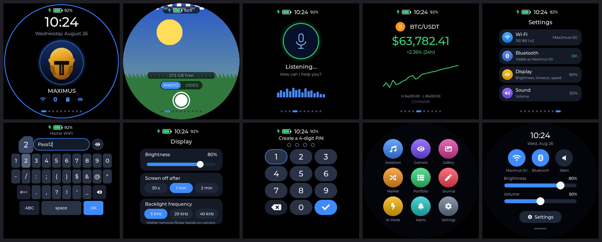

# Maximus OS for the SenseCAP Watcher W1-B

An AI companion firmware for the round-screen SenseCAP Watcher (ESP32-S3): voice assistant, live crypto prices, trading signals, voice journal and a Telegram bot, all driven by one rotary knob.



*Screens rendered by the host simulator from the real UI code (`sim/`).*

## Install in one click

1. Open the installer page (GitHub Pages: `https://drfxai.github.io/Maximus-OS--SenseCAP-Watcher-W1-B/` once the first build has deployed) in **Chrome or Edge** on a computer.
2. Plug in the Watcher with a USB-C data cable and press **Install Maximus OS**. One image holds the bootloader, partition table and app, so a fully wiped device is fine.
3. Enter Wi-Fi and your relay details on the same page and press **Send to watch**.

The relay (Telegram bot + AI) is a free Cloudflare Worker, set up in about five minutes: see [docs/CLOUDFLARE.md](docs/CLOUDFLARE.md).

## Touch and knob

| Gesture | Result |
|---|---|
| Swipe right-to-left / left-to-right | Next / previous page (on a sub-page: Back) |
| Swipe top-to-bottom | Quick panel: Wi-Fi, Bluetooth, silent, brightness and volume sliders |
| Swipe bottom-to-top | App grid |
| Drag a list, tap a row | Scroll, open |
| Knob turn | Next / previous page, or move the highlight in a list or keyboard |
| Knob click | Select |
| Knob hold 2 s / 5 s | Home / power off |

## What's in it

| Area | Details |
|---|---|
| **AI assistant** | Press the knob, speak, get an answer on screen. Audio goes to your Worker (Whisper for speech-to-text, then an LLM). Four modes carried over from Maximus Matrix OS: Trading, Market Analysis, News & Sentiment, General. |
| **Telegram** | Chat with the same assistant from Telegram (text or voice notes), `/price`, `/mode`, `/watch <text>` to push a message to the watch, and the watch can send you camera photos and journal entries. Serverless: runs on Cloudflare Workers. |
| **Markets** | Price, 24 h change, hourly sparkline and high/low for up to four coins; portfolio value from your holdings. Price source chain (Coinbase, Kraken, CoinGecko) ported from GeekMagic-Ultra. |
| **Signals** | TradingView alerts posted to the Worker show up on the watch as an alert screen with the RGB ring flashing; notes like "stop loss hit" turn it red. Same alert JSON as GeekMagic-Ultra. |
| **Clock** | SNTP with a relay-time fallback and the on-board RTC, POSIX time zones with daylight saving. |
| **Voice journal** | Press, talk, press: transcribed and saved on the watch, mirrored to Telegram. |
| **Security** | 4-digit PIN lock (hashed with a per-device salt), auto-lock after 5 minutes idle. |
| **RGB ring** | Green listening, blue thinking, purple processing, orange warning, red critical. |
| **Camera** | Settings > Camera sends a photo to Telegram (see [docs/HARDWARE.md](docs/HARDWARE.md)). |

## Repo layout

```
firmware/   ESP-IDF 5.2 app (LVGL 8 on Seeed's Watcher board support package)
  main/ui/    all screens; no ESP-IDF includes, so it also builds on a PC
worker/     Cloudflare Worker: Telegram webhook, AI, voice, prices, signals
site/       the one-click installer page (ESP Web Tools + Web Serial setup)
sim/        host build of the UI that renders screenshots
tools/      asset generator, dependency fetch, screenshot montage
docs/       Cloudflare setup, hardware notes
```

## Building yourself

CI builds and publishes everything (`.github/workflows/build.yml`). Locally:

```bash
tools/fetch-deps.sh                          # Seeed BSP + LVGL 8.4, pinned
cd firmware && . $IDF_PATH/export.sh         # ESP-IDF 5.2.x
idf.py set-target esp32s3 && idf.py build
cd build && esptool.py --chip esp32s3 merge_bin -o ../../site/firmware/maximus-os-full.bin @flash_args
```

UI screenshots without hardware: `git clone --depth 1 -b v8.4.0 https://github.com/lvgl/lvgl .sim-deps/lvgl && make -C sim && ./sim/render out && python3 tools/sim_montage.py out screens.png`.

Worker tests: `cd worker && npm test`.

## Credits

Built on Seeed Studio's [SenseCAP Watcher firmware SDK](https://github.com/Seeed-Studio/SenseCAP-Watcher-Firmware) (Apache-2.0) for display, touch, audio, knob and camera drivers. Signal and price logic from GeekMagic-Ultra; assistant personas from Maximus Matrix OS.

## v2 highlights

- **Camera**: photo and video (MJPEG AVI, no audio) saved to `/DCIM` on a FAT32 TF card. **Gallery** plays them back.
- **Settings on the device**: Wi-Fi (on/off, scan, password), Bluetooth, brightness, screen timeout (30 s / 1 min / 2 min), date and time, display speed.
- **Knob**: click selects, hold 2 s goes Home, hold 5 s powers off.
- **Battery icon** with a charging bolt.
- **Two-stage installer** (web page): identify the device, erase and install the ESP32-S3 firmware, then install the camera chip (Himax WE2) firmware.

## v2.1

- **Camera chip install fixed**: the Watcher's USB-C goes through a CH342 bridge to the ESP32's UART0, but v2 only listened on the chip's native USB port, so the installer never got an answer. The console now listens on both, and the installer tries both CH342 ports.
- **Settings no longer restarts the watch**: in v2 a vertical swipe moved a hidden highlight and the next tap anywhere ran it, which could land on Restart. Taps now act only on what is under the finger, and Restart / Power off ask first.
- **Battery and charging**: read from the charger's pins every second (the board package reads the charge pin inverted) and smoothed.
- **New touch UI**: swipe gestures in all four directions, app grid, quick panel, scrolling lists, a phone-style keyboard (nearest-key hit testing, key preview, hold-to-repeat backspace) and a PIN pad.
- **Display**: test patterns (Settings > Display > Test patterns) and a backlight frequency option (5 / 20 / 40 kHz). Bands that show up only in phone photos of the screen usually come from the backlight PWM; a higher frequency should remove them.

The camera chip firmware is Seeed's stock SSCMA image (Apache-2.0, from Seeed-Studio/SenseCAP-Watcher-Firmware), fetched by `tools/fetch-deps.sh` and bundled; Maximus OS does not ship its own Himax firmware. Features are untested on real hardware at the time of writing.

## v2.2

- **Display matched to the factory firmware**: full brightness and a 40 kHz backlight by default (the backlight no longer pulses at 5 kHz, which shows as bands), gradient dithering off (its error-diffusion pattern can look like fine vertical streaks), and the panel back at its normal speed. Settings saved by older versions move to these values once.
- **Touch**: a filter between the touch controller and the UI ignores short "finger lifted" drop-outs and single misread points. Those made one tap type several letters, and could turn a tap into a swipe that left the page. The keyboard also ignores a second press within 90 ms of a release.
- **Restarts are reported**: after a crash, watchdog or brownout the watch adds a "Restarted" note, and `MAXIMUS_STATUS` says why it last started.
- **Video sound**: videos record the microphone as a 16 kHz PCM track next to the MJPEG frames, and the gallery plays it back. Older silent videos still play.
- **LED ring**: green while charging, blue when full, red below 30 % on battery, soft blue while the Assistant is open, three blue blinks for a notification on battery (a steady blue glow on the charger).
- **Sounds**: new synthesized chimes (glass and marimba style) for notifications, assistant replies, charger in and out, microphone on and off, camera, errors and power off. They play in the background, so the UI no longer waits for them.

The camera chip (Himax WE2) only drives the camera; it has no connection to the display, so it cannot improve screen quality.

## v2.3

- **Settings no longer restart the watch**: writing a setting to flash turns the CPU cache off, and the display task, whose stack lives in PSRAM, aborted the chip when it did that. Every option changed on screen (Wi-Fi password, sound, time zone, brightness and volume in the quick panel) restarted the watch, which looked like a jump to Home. Saves from such tasks now go through a small task with its stack in internal RAM.
- **Drawing mode** (Settings > Display > Drawing): *Factory* (the default) draws exactly like Seeed's firmware, into two full-frame buffers in PSRAM; *Fast* uses 32-row buffers in internal RAM. Applies after a restart. Holding the knob at power-on goes back to Factory.
- **Web console** (Settings > Web console): the watch opens a hotspot `Maximus-XXXX` (the password is shown on the watch) and serves `http://192.168.4.1` with the status, a live log you can copy or download, the log from before the last restart, and the last crash (task, address, backtrace from the new coredump partition). On the home network the page is also at the watch's own address.
- CI publishes the firmware ELF next to the image (`site/firmware/maximus-os.elf`) so backtraces can be decoded.

## v2.3.1

- Back to fast drawing by default: the factory drawing mode left the screen white after installing 2.3.0. It stays available under Settings > Display > Drawing for testing, and holding the knob while powering on returns to the fast mode.

## v2.3.2

- **Fixes the white (2.3.0) and black (2.3.1) screen**: the web console's 48 KB log buffer was meant for PSRAM, but the "noinit PSRAM" option it relied on exists only on the original ESP32, so on this chip it landed in internal RAM. That left too little DMA memory for the display. The live log now sits in ordinary PSRAM, and only its last 3 KB are kept across a restart, in RTC memory. Internal RAM use is back to 2.2's level.
- The draw buffers are sized to the DMA memory that is free (32 rows normally, down to 8), so running short slows drawing down instead of blanking the screen. The serial log prints the memory figures before the display starts, and `MAXIMUS_STATUS` reports `display` (rows, 0 = failed) and `dma_free`.
- If the display still cannot start, the LED ring turns red and the serial console keeps working.
- CI prints the firmware's static RAM use (`idf.py size`).

## v2.3.3

- **Fewer streaks**: the faint vertical streaks show while the panel receives a picture and fade a few seconds after it stops. Every page used to rewrite all its texts, colours and flags five times a second, and LVGL redrew each one even when nothing changed, so menus never went quiet. The setters now skip writes that change nothing (`ui/lv_quiet.c`, routed in by the linker), the journal wave only moves while recording, and the password cursor no longer blinks. The simulator checks that every idle page sends nothing to the panel for 3 s (`idle pages redrawing: 0`), and CI fails otherwise.
- Redraw at about 33 fps, like Seeed's firmware, instead of 60: an animation sends half as many frames.
- **Internal RAM**: LVGL's objects, about 6,700 small blocks for the Maximus pages, now live in PSRAM (`CONFIG_LV_MEM_CUSTOM_INCLUDE`, header written by `tools/fetch-deps.sh`). 2.3.2 ran down to 3 KB of free internal RAM. The boot log prints the free internal RAM after each start-up step.
- The web console answers `/favicon.ico`, so browsers no longer leave a 404 in the log.

## v2.3.4

- **Wi-Fi, web console and Bluetooth start again.** The installer erases the watch, so 2.3.3 came up in the "fast" drawing mode, whose two draw buffers take about 52 KB of internal RAM. That left too little for the Wi-Fi hotspot and the Bluetooth controller. Factory drawing (full frames in PSRAM, like Seeed's firmware) is now the default, and every watch switches to it once (new setting key). Fast drawing is still under Display, marked as possibly stopping the radios. Holding the knob at power-on goes back to factory drawing and normal panel speed.
- A Wi-Fi, hotspot or Bluetooth start that fails is logged with the free internal RAM. The installer's status line shows the last failure (`radio_err`) and the free and lowest internal RAM.
